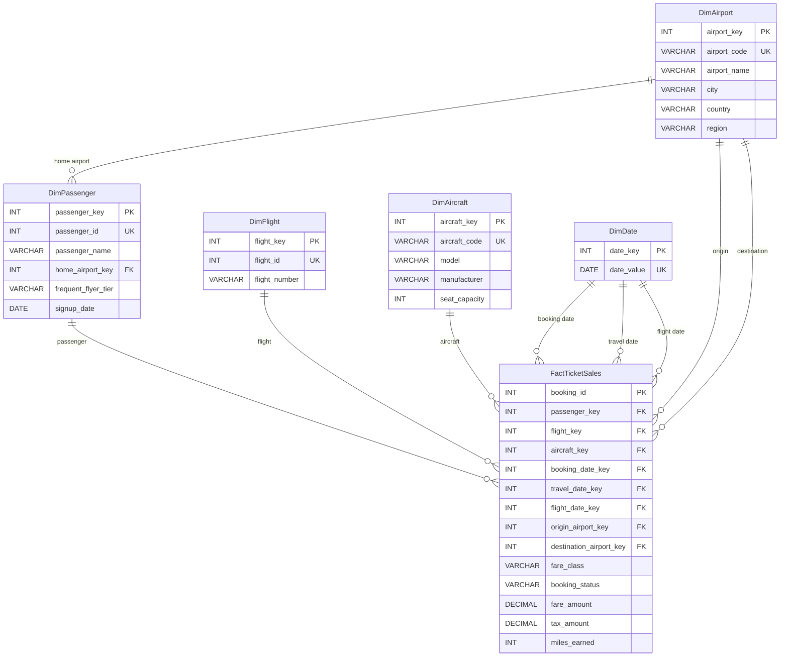

# Airline data warehouse

A star schema in the `dw` schema on SQL Server. **One row in `FactTicketSales` is one passenger booking** for a specific flight, identified by `booking_id`.

- `PK`primary key
- `FK`foreign key
- `UK`unique business key

## Role-playing dimensions

`DimDate` connects to the fact table three times (booking, travel, flight) and `DimAirport` twice (origin, destination).

## One snowflaked link

`DimPassenger` points to `DimAirport` through `home_airport_key`, so the model is a star with a single outrigger.

## Measures

Additive measures are `fare_amount`, `tax_amount` and `miles_earned`. `booking_id` is a degenerate dimension.